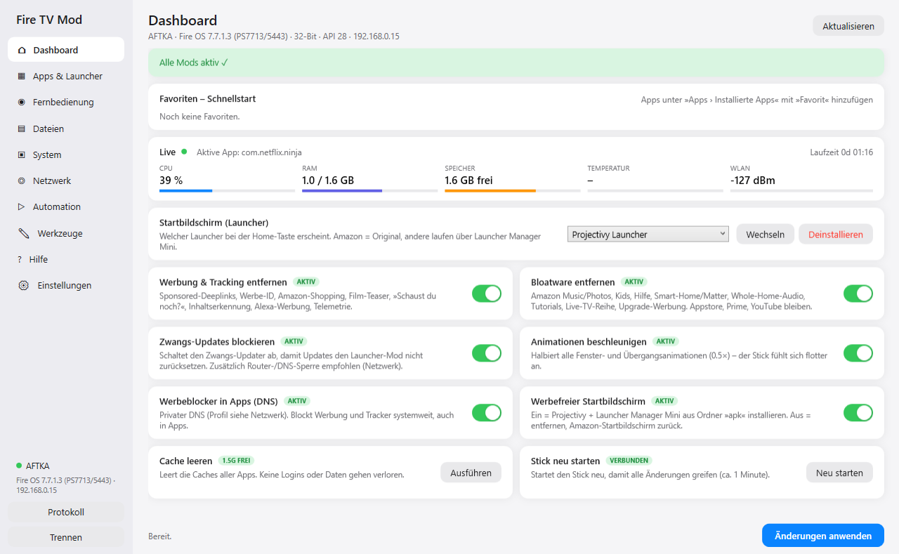

# Fire TV Mod Launcher

  

Ein Windows-Tool (PowerShell + WPF, keine Installation nötig), das einen Amazon Fire TV Stick per ADB über WLAN entwirbt, entschlackt und erweitert – mit grafischer Oberfläche im Apple-Stil.

> Deutsch · [English summary below](#english)



## Funktionen

| Bereich | Was es kann |
|---|---|
| **Dashboard** | Live-Werte (CPU, RAM, Speicher, Temperatur, WLAN), Mod-Status-Banner, Fire-OS-Update-Wächter, Favoriten-Schnellstart, Launcher-Wechsel |
| **Mods (Schalter)** | Werbung & Tracking deaktivieren · Bloatware deaktivieren · Zwangs-Updates blockieren · Animationen beschleunigen · Werbeblocker-DNS · werbefreier Startbildschirm |
| **Apps & Launcher** | Katalog mit automatischem Download der passenden Variante (32/64-Bit), Update-Prüfung, APK aus Link, 13 alternative Launcher, installierte Apps verwalten (Start/Stop/Daten/Backup/Deinstallation/Favorit/Ausblenden), Berechtigungen, laufende Prozesse mit **Aufzeichnung über Zeit** (CSV + Auswertung der Hintergrund-Dauerläufer) |
| **Fernbedienung** | D-Pad, Medien- und Lautstärketasten, Texteingabe per Tastatur, Screenshot, Bildschirmaufnahme |
| **Dateien** | Dateien auf den Stick kopieren / zurückholen / löschen, Bildschirmschoner-Fotos |
| **Automation** | Makros (Befehlsketten) und Zeitpläne über die Windows-Aufgabenplanung, headless ausführbar |
| **System** | **Hintergrundprozesse begrenzen**, Auflösung/DPI, Ruhezustand, Standby/Wake, Gerätename, HDMI-CEC, Profil exportieren/importieren, APK-Backup, Komplett-Backup, Werks-Reset, Rollout auf mehrere Sticks |
| **Netzwerk** | WLAN-Status, Ping, DNS-Profile (AdGuard, Mullvad, Cloudflare, Quad9, eigener Server), Update-Sperr-Hosts, VPN-Apps, Speedtest |
| **Werkzeuge** | **Konsole für eigene adb-Befehle** (Verlauf, Beispiele), Geräteinfo, Logcat mit Filter, Bluetooth, Protokoll-Export |
| **Einstellungen** | Dark Mode, Auto-Verbinden, Autostart mit Windows, Selbst-Update |

Alles ist **reversibel**: System-Apps werden nur deaktiviert, nie gelöscht.

## Voraussetzungen

- Windows 10/11 (PowerShell 5.1 ist vorinstalliert)
- Fire TV Stick im selben WLAN, **ADB-Debugging eingeschaltet** (Einstellungen → Mein Fire TV → Entwickleroptionen)
- Internet für den einmaligen ADB-Download (Google platform-tools) und den App-Katalog

Getestet mit Fire TV Stick 4K Max (1. Gen, AFTKA, Fire OS 7.7). Andere Sticks: Der Launcher erkennt Architektur (32/64-Bit) und Android-Version automatisch und wählt passende Downloads; Funktionen, die ein neueres Fire OS brauchen (z. B. WLAN wechseln), werden ausgegraut.

## Schnellstart

1. Repository als ZIP laden und entpacken (oder klonen).
2. `FireTV Mod Launcher.bat` doppelklicken (oder `.vbs` für Start ohne Konsolenfenster).
3. Assistent: ADB-Debugging → IP → Verbinden. Am TV »USB-Debugging zulassen« mit »Immer zulassen« bestätigen.
4. Im Dashboard Schalter setzen → **Änderungen anwenden**.

### Werbefreier Startbildschirm
Alternative Launcher laufen auf Fire OS über **Launcher Manager Mini** (am TV per Downloader-App, Code `632067`). Launcher wie Projectivy, Wolf oder Button Mapper dürfen nicht mitgeliefert werden – APK selbst laden und in den Ordner `apk/` legen; der Katalog erkennt sie automatisch. Open-Source-Launcher (LTvLauncher, FLauncher, Leap, AT4K, …) lädt der Launcher direkt von GitHub/GitLab.

## Ordnerstruktur

```
FireTV_Mod_Launcher.ps1       Hauptprogramm (GUI + Headless-Modus)
FireTV Mod Launcher.bat/.vbs  Starter (mit / ohne Konsole)
FireTV Mod Launcher (Debug).bat  schreibt Fehler in launcher_fehler.txt
version.txt                   Version für das Selbst-Update
scripts/                      Einzelne Batch-Skripte ohne GUI (Fallback, siehe scripts/README.md)
docs/                         FAQ, Changelog, Screenshots
apk/                          manuelle APKs (Projectivy, Launcher Manager Mini, Wolf, Button Mapper)
apk_sideload/                 automatische Downloads des Katalogs
backups/ screenshots/ downloads/   Arbeitsordner (nicht im Repo)
```
Zur Laufzeit entstehen zusätzlich `platform-tools/` (ADB), `geraete.json`, `einstellungen.json`, `launcher_log.txt`.

## Headless / Zeitpläne

```
powershell -ExecutionPolicy Bypass -File FireTV_Mod_Launcher.ps1 -Run "Gute Nacht" -Device 192.168.0.15
```
Die Seite **Automation** legt solche Aufrufe als Windows-Aufgaben an.

## Selbst-Update

In den Einstellungen die Raw-URL dieses Repos eintragen, z. B. `https://raw.githubusercontent.com/<user>/FireTV-Mod-Launcher/main` – der Launcher vergleicht `version.txt` und lädt bei Bedarf die neue `.ps1`.

## Sicherheit & Haftung

- Das Tool nutzt ausschliesslich dokumentierte ADB-Befehle (`pm`, `settings`, `am`, `input`). Kein Root, kein Firmware-Eingriff.
- Deaktivierte Amazon-Dienste lassen sich jederzeit wieder einschalten (Schalter aus → Anwenden, oder `scripts/9_rueckgaengig.bat`).
- Fire-OS-Updates können Mods zurücksetzen. Der Launcher warnt, wenn sich die Version geändert hat.
- Nutzung auf eigene Verantwortung. Nicht mit Amazon verbunden. Alle Produktnamen gehören ihren Eigentümern.

## Mitwirken

Issues und Pull Requests willkommen – besonders Rückmeldungen zu anderen Stick-Modellen (Lite, 4K 2. Gen, 4K Max 2. Gen, Cube) und Katalog-Quellen, die eine andere Datei liefern als erwartet. Das Protokoll (Werkzeuge → Protokoll → Als Datei speichern) hilft bei jeder Meldung.

## Lizenz

MIT – siehe [LICENSE](LICENSE).

---

## English

**Fire TV Mod Launcher** is a portable Windows GUI (PowerShell/WPF) that de-ads, debloats and extends Amazon Fire TV Sticks over ADB/Wi-Fi: ad & telemetry packages off, bloatware off, forced-update blocker, faster animations, ad-blocking private DNS, custom home screen via Launcher Manager Mini, background-process limiting and recording, a built-in adb console, an app/launcher catalog with automatic 32/64-bit asset selection and update checks, a remote control with text input and screenshots, file transfer, macros with Windows Task Scheduler, display/power/CEC settings, profile export/import and rollout to multiple sticks, network tools, logcat, dark mode and self-update. Everything is reversible (packages are disabled, never deleted). UI language is German. Requires Windows 10/11 and a stick with ADB debugging enabled. MIT licensed, not affiliated with Amazon.
